  

<h1 align="center">Petal</h1>

A file conversion wheel for your Wayland desktop.

  <a href="https://github.com/xoalt/petal/releases">Download</a> ·
  <a href="docs/guides/installation.md">Install</a> ·
  <a href="docs/README.md">Documentation</a> ·
  <a href="https://github.com/xoalt/petal/issues">Report an issue</a>

  
  

  

Drop a file, choose a format, and convert it locally. Petal brings a radial wheel, editing tools, and a file shelf to Linux, with settings in a separate window.

For Linux desktops using **Wayland**, with a system tray menu. Inspired by [Tangerine for macOS](https://tangerineformac.com/) by Leap Studio; Petal is an unofficial, independently written Linux reimplementation.

**Beta release.** Petal is under active testing; check [known limitations](docs/guides/limitations.md) before relying on a conversion workflow.

## Get started

1. Download and extract a [Linux release](https://github.com/xoalt/petal/releases).
2. Install the [desktop requirements](docs/guides/installation.md#requirements) for your distribution.
3. Run `./petal-run` and complete first-launch setup.

The release contains source files, so Python 3.11+, GTK4, PyGObject, pycairo, and Pillow are required. Add gtk4-layer-shell for Wayland layers. [Full installation guide →](docs/guides/installation.md)

## On your desktop

- **One wheel, three modes.** Shift for formats, Alt for tools, Ctrl for file actions.
- **Local conversions.** Images, audio, video, documents, PDFs, subtitles, and archives. [Format support →](docs/guides/formats.md)
- **Your choice of apps.** Pick your file manager, viewers, conversion programs, colors, and animation preferences.
- **Separate surfaces.** Open the wheel from a shortcut or tray, use the floating drop target, and pin files to the shelf.

Click the center to select files, or drag them onto the wheel. An empty leaf shows **“Select or drag a file”** and briefly shakes. Right-click the tray icon to open Settings.

Conversion support depends on the programs and codecs installed. Petal checks their capabilities and shows missing features. [Software setup →](docs/guides/software.md) · [Known limitations →](docs/guides/limitations.md)

## Explore

| | |
| --- | --- |
| [Using Petal](docs/guides/usage.md) | Wheel controls, keyboard shortcuts, tray, and shelf |
| [Wayland setup](docs/guides/wayland.md) | Shortcut example and separate layer namespaces |
| [Command line](docs/guides/cli.md) | Conversion commands, diagnostics, and local storage |
| [Contributing](CONTRIBUTING.md) | Project layout, development, and checks |
| [Release verification](docs/release-verification.md) | What was tested and the limits of those checks |

## Credits and license

Petal’s code is [MIT licensed](LICENSE). [Tangerine](https://tangerineformac.com/) is the original macOS project by Leap Studio. Petal is not affiliated with Tangerine, and no original source repository was supplied or verified. Original Tangerine graphics are not redistributed.

See [credits](docs/credits.md) for artwork and third-party licenses.
