<p align="center"></p>

# Petal

A native, offline file conversion wheel for Linux and Wayland. Open the wheel, choose a file, and select a format or tool. Original files stay unchanged when converting and editing.

**Petal is an unofficial Linux port/reimplementation of [Tangerine for macOS](https://tangerineformac.com/) by Leap Studio.** Its interaction design inspired this project. Petal has independently written code; no original source repository was supplied or verified. It is not an official release or source-code fork. Original Tangerine graphics are not distributed here.



## Run

Download and extract the Linux archive from [Releases](https://github.com/xoalt/petal/releases), keep the folder in a permanent location, then run:

```sh
./petal-run
```

Core requirements: Python 3.11+, GTK4, PyGObject with Cairo integration, pycairo, and Pillow. gtk4-layer-shell enables the separate Wayland layers; without it Petal falls back to ordinary windows. On Arch/CachyOS the package names are `python`, `gtk4`, `python-gobject`, `python-cairo`, `python-pillow`, and `gtk4-layer-shell`. Obtain core runtime dependencies through your distribution software manager. Petal does not install them silently.

First launch walks through Software, Applications, Appearance, and Preferences. Program lists start with **Choose a program…** and include **Other program…** for a compatible external executable. No replacement program or download is preselected. Checks use temporary samples and show which exports passed before accepting an external program.

Optional desktop entry and `~/.local/bin/petal` launcher:

```sh
python3 install.py
```

This only creates user-local launchers pointing at the extracted folder. It leaves system defaults, autostart, compositor rules, and preferences alone. Existing unrelated launchers are never overwritten. Remove the managed launchers with `python3 install.py --remove`; app files and preferences remain.

## Use the wheel

- Click the middle to browse for files, or drag files onto a leaf.
- Clicking a leaf with no file opens the picker and remembers that action. After selecting a compatible file, click the highlighted leaf or press Enter. Selection alone does not start an unexpected conversion.
- Shift selects formats, Alt selects tools, and Control selects file actions. Both left and right keys work. The selected mode stays after release. Opening the wheel explicitly requests keyboard focus only while it is visible; hiding it returns the keyboard to other apps. Passive drag previews do not take exclusive keyboard focus, and read modifiers from drag events instead.
- Arrow keys select a leaf; Enter applies it. Page Up/Down or scrolling changes pages. Ctrl+O opens the picker. Escape dismisses the current popup or wheel.
- Right-click, Menu, or Shift+F10 opens native, named action buttons as an alternative to the drawn wheel.
- The Noctalia tray icon opens the wheel; right-click it for Settings, Software checks, the floating target, shelf, Activity, and Quit.

The optional floating target reveals the wheel when files hover over it. Dropping on the target loads files for a later choice. The shelf pins file references for dragging into another app; removing a shelf item does not delete the file.

Settings remain separate from the wheel. Choose a file manager, terminal, sharing app, image viewer, media player, and document viewer there. These choices affect Petal, not system-wide file associations. Appearance includes presets, custom colors, light/dark/system mode, opacity, and reduced animation. Settings and editor pages scroll to remain usable on smaller screens and with larger text.

## Formats and tools

| Input | Outputs / tools | Program used when required |
| --- | --- | --- |
| Images | JPG, PNG, WebP, HEIC, TIFF, AVIF, BMP, PDF, image-in-DOCX; compress, adjust, crop, resize, rotate, annotate, redact, backgrounds, collage | ImageMagick; Pillow for previews and photo tools |
| Audio | MP3, M4A, WAV, FLAC, OGG, Opus, AIFF, WMA; trim, channels, volume, speed, normalize, mute ranges, merge, waveform video | FFmpeg, FFprobe, FFplay for playback |
| Video | MP4, MOV, MKV, WebM, AVI, WMV, GIF, MP3 extraction; resize, crop, rotate, trim, mute, split, redact, snapshots, merge | FFmpeg and FFprobe |
| PDF | DOCX/EPUB/TXT/MD text export; PNG/JPG pages; merge, split, organize, rotate, metadata, content-stream compression | Poppler for extraction/rendering; vendored pypdf for page tools |
| Documents | PDF, DOCX, ODT, RTF, TXT, HTML, EPUB, PNG/JPG | Compatible LibreOffice command interface; formatted Markdown needs Pandoc |
| Slides | PDF, PPTX, ODP, PNG/JPG | Compatible LibreOffice command interface |
| Spreadsheets | XLSX, ODS, CSV, TSV, PDF | Compatible LibreOffice command interface; CSV/TSV conversion also works directly |
| Subtitles | SRT, VTT, TXT; time shift | Built in |
| Archives / folders | ZIP, TAR, TAR.GZ creation and safe extraction; RAR/7Z/XZ extraction | Built in; compatible 7-Zip command interface for extra archive types |

Actions include Open, shelf, file/path clipboard, explicit Move, Terminal, and Share using the selected application. Linux cannot provide Apple's AirDrop or Apple-only export formats.

## Software choices and downloads

Settings → Conversions → Check features, or tray → Check software, shows Ready, Some features missing, Not installed, or Needs attention. Expand a group to see individual checks. Being installed alone does not make an engine Ready.

Choose the program yourself. For office exports the repository list contains LibreOffice Fresh and Still without a preferred selection. External programs must expose a supported conversion command interface; an ordinary viewer cannot automatically replace a batch conversion engine. Failed checks explain what was unavailable and keep the existing selection. Compatible selected engines are used for actual conversions, not just for opening files.

On Arch/CachyOS, opt into downloads for selected programs, review the package names, then press **Download and install**. Your selected terminal opens the system package installer, which shows dependencies/sizes and requests confirmation and authentication. The helper accepts only predefined package plans. It does not execute shell command text, run AUR scripts, bypass signatures, force dependency changes, refresh repositories, or upgrade the system. After completion Petal checks capabilities again. Closing first-launch setup discards draft preferences; explicitly approved package installations remain installed.

Other distributions, unavailable terminals, stale repositories, or unsupported programs use your normal software manager or the selected program's external download page. An installation failure is reported; no forced repair is attempted. Formatted Markdown → PDF may require a separate compatible PDF engine; installing Pandoc alone does not guarantee that route.

## CLI and storage

```sh
./petal-run --help
./petal-run --version
./petal-run --tray
./petal-run --settings
./petal-run --software
./petal-run --setup
./petal-run --check
./petal-run --doctor
./petal-run convert ./photo.png --to webp
./petal-run convert ./clip.mov --to mp4 --output-dir ./converted
./petal-run --quit
```

`--check`, `--doctor`, `--help`, `--version`, and conversions do not require a desktop display. `--doctor` exits 1 when a feature is unavailable, which is expected if optional engines are absent. `--setup` reopens first-launch preferences.

Settings and local history live in `$XDG_STATE_HOME/petal`, normally `~/.local/state/petal`. Override with `PETAL_STATE_DIR`. History contains local input/output paths; it is never uploaded and is excluded from releases. `PETAL_LIBREOFFICE` and `PETAL_ENGINE_PATHS` can specify existing engines; validated Settings choices are preferred. No account, telemetry, or conversion-upload service is included. Optional package downloads use the distribution's configured repositories.

## MangoWM / Wayland

See [the optional shortcut example](integration/mango.conf.example). Petal never modifies live compositor configuration. Four separate layer-shell namespaces are available:

| Surface | Namespace |
| --- | --- |
| Wheel | `petal-wheel` |
| Floating target | `petal-drop-target` |
| Shelf | `petal-shelf` |
| Settings | `petal-settings` |

Editors, progress, setup, and software checks are normal windows. Blur and positioning follow your compositor. The wheel supports alpha transparency and independent expanding hover animation, without an outer backing. It does not globally intercept modifier keys while hidden or read input devices. A global drag-anywhere trigger requires compositor support; use your shortcut and/or floating target.

## Limits

This is not a complete or pixel-identical replica of Tangerine. Linux fonts, widgets, material effects, codec builds, and compositor behavior differ. The tested desktop is MangoWM/Wayland with Noctalia; other desktops may need adjustment.

- Image → DOCX embeds the image; it does not perform OCR.
- PDF → DOCX/EPUB/MD extracts text without rebuilding tables, images, or page layout. Scans need an external OCR workflow. PDF → PPTX/XLSX reconstruction and Apple Pages/Keynote exports are not included.
- Bleep Audio mutes selected ranges rather than synthesizing a tone.
- Photo adjustments approximate the named controls; crop/annotation/redaction use parameter controls and previews rather than a complete canvas editor.
- Compression can produce a larger file. Codec support depends on the selected engine. Sample checks cannot certify every source file, input/output combination, or parameter.
- Inputs are read-only during conversions. Outputs use collision-safe names. Cancellation/failure removes staging; a filesystem failure during publication can leave already-published results. Move is a separate, explicitly chosen operation that changes file locations.
- Archive extraction rejects traversal, links, and special files, with a 4 GiB / 50,000-entry expansion budget. Conversion engines process local files; keep those system programs updated.
- Native keyboard controls and accessible action buttons are tested, but full screen-reader certification is not claimed. User-selected colors and translucent wheel text may need adjustment for their wallpaper and contrast needs.

## Development and verification

See [CONTRIBUTING.md](CONTRIBUTING.md), [UX decisions](docs/ux.md), [release verification](docs/release-verification.md), and [security policy](SECURITY.md).

```sh
python3 -m unittest discover -s tests -v
./scripts/run_native_checks.sh
python3 scripts/build_release.py
```

MIT for Petal's code. [Asset and third-party credits](assets/NOTICE.txt) include the independently generated Petal logo and pypdf's upstream license. Tangerine remains the original macOS project, credited and linked above.
